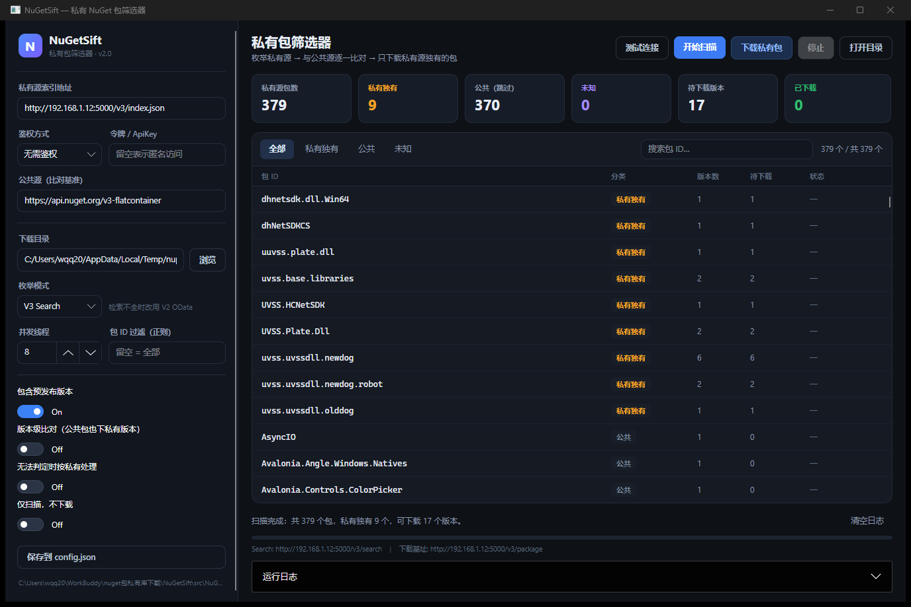

# NuGetSift

[](https://github.com/OPEN96/NuGetSift/actions/workflows/ci.yml)
[](https://github.com/OPEN96/NuGetSift/actions/workflows/release.yml)
[](LICENSE)
[](https://dotnet.microsoft.com/)
[](#环境要求)

> 枚举私有 NuGet 源，与 nuget.org 逐一比对，**只下载「仅存在于私有源」的包**，并生成私有 / 公共区分报告。

团队把包推送到自建 NuGet 源（BaGet / Bagetter / Nexus / Artifactory 等）后，往往分不清哪些是团队自研的私有包、哪些是从 nuget.org 镜像过来的公共包。NuGetSift 用「包 ID 是否存在于公共源」这一明确规则自动区分，帮你把真正需要备份 / 迁移 / 归档的私有包精确挑出来，支持**桌面客户端**与**命令行**两种形态。



---

## 目录

- [功能特性](#功能特性)
- [两种形态](#两种形态)
- [环境要求](#环境要求)
- [安装](#安装)
- [快速开始](#快速开始)
- [基础用法](#基础用法)
- [配置说明](#配置说明)
- [工作原理](#工作原理)
- [构建与发布](#构建与发布)
- [项目结构](#项目结构)
- [常见问题](#常见问题)
- [贡献指南](#贡献指南)
- [许可证](#许可证)

---

## 功能特性

- **自动区分私有 / 公共**：包 ID 在公共源（nuget.org）上返回 404 → 判定「私有独有」→ 下载其全部版本。
- **兼容多种私有源**：任何兼容 NuGet V3 协议的源，包括 Bagetter、BaGet、Nexus、Artifactory、Azure Artifacts 等。
- **两种枚举模式**：
  - `search`（默认，V3 Search）：健壮翻页，翻到空页 / 本页无新增即止，**不受 `totalHits` 截断影响**，不会只拿到前 100 个。
  - `v2`（V2 OData）：直连 `Packages()` 全量列举，适合超大私有源或 search 检索不全的场景。
- **自适应包文件基址**：直接使用服务索引里的 `PackageBaseAddress`（Bagetter 为 `/v3/package`，标准 BaGet 为 `/v3/flatcontainer`），不硬编码路径。
- **下载兜底自愈**：标准路径失败时，自动回退读取 registration 叶子里的 `packageContent`（最权威的下载地址）。
- **写盘前安全校验**：`.nupkg` 本质是 ZIP，必须以 `PK\x03\x04` 开头；下到 JSON / HTML 会直接判失败，**绝不写出假包**。
- **版本级比对**（可选）：公共包也下载「nuget.org 上没有的那几个版本」。
- **并发与可取消**：下载并发数可配，命令行 `Ctrl+C`、界面「停止」均可随时中断。
- **区分报告**：自动输出 Markdown / CSV，含私有 / 公共 / 未知分类与下载结果。

---

## 两种形态

| 形态 | 项目 | 适用场景 |
| --- | --- | --- |
| 🖥️ 桌面客户端 | `src/NuGetSift.Desktop` | 图形界面操作，实时进度、统计卡片、运行日志，适合一次性人工操作 |
| ⌨️ 命令行 | `src/NuGetSift.Cli` | 脚本 / CI / 服务器 / 定时任务，一条命令完成全流程 |

两者共用同一套引擎 `src/NuGetSift.Core`，判定规则与行为完全一致。

---

## 环境要求

### 运行已编译程序

| 项目 | 要求 |
| --- | --- |
| 操作系统 | Windows 10+、Linux（glibc 2.17+）、macOS 11+；支持 x64 / ARM64 |
| 运行时 | **无需安装 .NET**：发布产物为自包含单文件，已内嵌运行时 |
| 网络 | 需要能访问私有 NuGet 源；比对环节需要能访问 `https://api.nuget.org` |
| 磁盘 | 取决于待下载包体积（曾实测含 179 MB 大包的场景） |

### 从源码构建

| 项目 | 要求 |
| --- | --- |
| SDK | **.NET 10 SDK**（项目目标框架 `net10.0`） |
| 构建工具 | Git；Windows 建议 Git Bash 或 PowerShell，Linux / macOS 用 bash |
| 依赖还原 | 需要能访问 `https://api.nuget.org`（`nuget.config` 已固定为官方源，可复现还原） |
| 打包（可选） | PowerShell（`pwsh`）或 `zip`，用于生成发布压缩包 |

### 私有源要求

- 提供 NuGet **V3 服务索引**（`index.json`），且包含 `SearchQueryService` 与 `PackageBaseAddress` 端点；
- 若使用 `v2` 枚举模式，需额外提供 V2 OData 端点（通常为 `/v2`）；
- 若源启用了鉴权，需准备 API Key / PAT / Basic 账号。

> 没有私有源？可用 Docker 快速起一个本地测试源，见 [安装](#安装)。

---

## 安装

### 方式一：下载预编译程序（推荐）

前往 [Releases](https://github.com/OPEN96/NuGetSift/releases) 下载对应平台的压缩包，解压后直接运行：

| 平台 | 文件示例 |
| --- | --- |
| Windows x64 | `NuGetSift-v1.0.0-desktop-win-x64.zip` / `-cli-win-x64.zip` |
| Linux x64 | `NuGetSift-v1.0.0-desktop-linux-x64.zip` / `-cli-linux-x64.zip` |
| macOS ARM64 | `NuGetSift-v1.0.0-desktop-osx-arm64.zip` / `-cli-osx-arm64.zip` |

Linux / macOS 首次运行需赋予执行权限：

```bash
chmod +x NuGetSift.Desktop   # 或 NuGetSift
```

> 桌面客户端共 6 个架构；命令行额外提供 `linux-arm`（32 位 ARM），共 7 个架构。

### 方式二：从源码构建

```bash
git clone https://github.com/OPEN96/NuGetSift.git
cd NuGetSift
bash ./scripts/build.sh ci     # 还原 + 构建 + 自检（一条命令）
```

构建产物位于各项目的 `bin/Release/net10.0/`。

### 方式三：运行本地测试源（可选）

如果没有现成的私有源，可用 Docker 起一个 Bagetter 用于体验：

```bash
docker run --name nuget-server -p 5000:8080 bagetter/bagetter
# 服务索引：http://localhost:5000/v3/index.json

dotnet nuget push -s http://localhost:5000/v3/index.json *.nupkg --allow-insecure-connections
```

> 目标为 `http://` 时需 `--allow-insecure-connections`；若服务器开启 ApiKey 校验，追加 `-k <你的ApiKey>`。
> 国内拉取镜像超时可配置 registry mirror，例如 `{ "registry-mirrors": ["https://docker.1ms.run"] }`。
> 运维：`docker stop nuget-server` / `docker start nuget-server` / `docker logs -f nuget-server`。

---

## 快速开始

### 桌面客户端（推荐）

```bash
dotnet run --project src/NuGetSift.Desktop -c Release
```

1. 左侧填「私有源索引地址」（如 `http://192.168.1.12:5000/v3/index.json`），需要鉴权时选 Bearer / Basic 并填令牌；
2. 选择「下载目录」（默认在用户文档目录下）；
3. 点 **测试连接** 确认能读到服务索引；
4. 点 **开始扫描**：自动枚举并逐一与公共源比对，列表按「私有独有 → 未知 → 公共」排序；
5. 点 **下载私有包**：只下载私有源独有的版本，底部实时显示进度；完成后 `report.md` / `report.csv` 生成在下载目录。

界面还提供分段筛选、包 ID 搜索、统计卡片、可折叠运行日志，以及随时「停止」。

### 命令行

```bash
# 1. 生成默认配置
dotnet run --project src/NuGetSift.Cli -- --init

# 2. 编辑 config.json，把 BaGet.BaseUrl 改成你的私有源索引地址

# 3. 自检（验证公共 / 私有区分逻辑，只需访问 nuget.org）
dotnet run --project src/NuGetSift.Cli -- --selftest

# 4. 先试跑：只枚举 + 比对，不下载
dotnet run --project src/NuGetSift.Cli -- --dry-run

# 5. 正式执行
dotnet run --project src/NuGetSift.Cli
```

也可以完全不写配置文件，用命令行参数覆盖：

```bash
dotnet run --project src/NuGetSift.Cli -- \
  --baget-url "http://192.168.1.12:5000/v3/index.json" \
  --output-dir "./packages" --dry-run
```

---

## 基础用法

### 命令行选项

| 参数 | 说明 |
| --- | --- |
| `--help` / `-h` | 显示帮助 |
| `--init` | 生成默认 `config.json`（已存在则不覆盖） |
| `--selftest` | 自检：验证公共 / 私有区分逻辑（3 个用例，需访问 nuget.org） |
| `--dry-run` | 只扫描不下载，仍会生成报告 |
| `--limit <n>` | 只处理前 n 个包（按页截断，用于测试） |
| `--baget-url <url>` | 覆盖私有源索引地址 |
| `--output-dir <dir>` | 覆盖下载目录 |
| `--config <path>` | 指定配置文件路径（默认 `config.json`） |

### 退出码

| 码 | 含义 |
| --- | --- |
| `0` | 成功 |
| `1` | 配置错误 / 运行失败 / 自检未通过 |
| `130` | 被用户取消（`Ctrl+C`） |

### 输出产物

运行结束后，下载目录中会生成：

| 文件 | 说明 |
| --- | --- |
| `<id>.<version>.nupkg` | 私有独有的包，写盘前已校验 ZIP 文件头 |
| `report.md` | Markdown 区分报告（含汇总与分类明细） |
| `report.csv` | CSV 明细，便于 Excel / 脚本二次处理 |

报告为 UTF-8 无 BOM 编码。

---

## 配置说明

`config.json` 从 [`config.json.example`](config.json.example) 复制而来，字段如下：

| 字段 | 默认值 | 说明 |
| --- | --- | --- |
| `BaGet.BaseUrl` | `http://localhost:5000/v3/index.json` | 私有源 V3 服务索引地址 |
| `BaGet.ApiKey` | `""` | 鉴权令牌；无需鉴权时留空 |
| `BaGet.AuthType` | `none` | `none` / `bearer`（PAT）/ `basic`（`user:pass`） |
| `Public.FlatContainer` | `https://api.nuget.org/v3-flatcontainer` | 公共源 flatcontainer 基址 |
| `Output.Dir` | `downloaded_private_packages` | 下载目录 |
| `Output.ReportMd` / `ReportCsv` | `report.md` / `report.csv` | 报告文件名（写入下载目录内） |
| `Options.Threads` | `8` | 下载并发数 |
| `Options.PageSize` | `100` | search 分页大小 |
| `Options.IncludePrerelease` | `true` | 是否包含预发行版本 |
| `Options.VersionLevel` | `false` | 版本级比对：公共包也下载 nuget.org 缺失的版本 |
| `Options.EnumerateMode` | `search` | `search`（V3）或 `v2`（OData 全量列举） |
| `Options.V2BaseUrl` | `""` | `v2` 模式下的 OData 基址，如 `http://host:5000/v2` |
| `Options.IdFilter` | `""` | 按包 ID 过滤的正则，留空 = 全部 |
| `Options.TreatUnknownAsPrivate` | `false` | 比对失败（网络异常等）时是否按私有处理 |
| `Options.MaxRetries` | `3` | HTTP 重试次数 |

> ⚠️ **安全提示**：`config.json` 可能包含真实内网地址与令牌，已被 `.gitignore` 忽略，**请勿提交**。
> 桌面客户端把配置保存在**程序所在目录**的 `config.json`；命令行默认读取**当前工作目录**的 `config.json`。
> 请始终以 `config.json.example` 作为提交 / 分享的模板。

---

## 工作原理

1. **服务发现**：读取私有源 `index.json`，取得 `SearchQueryService` 与 `PackageBaseAddress` 两个端点。
2. **枚举**：列举私有源全部包及其版本（V3 Search 健壮翻页，或 V2 OData 全量）。
3. **比对**：逐包请求公共源 `flatcontainer/{id}/index.json`：
   - **404** → 私有独有 → 加入下载队列（全部版本）；
   - **200** → 公共 / 镜像 → 跳过（开启 `VersionLevel` 时，仅下载 nuget.org 上缺失的版本）；
   - 请求异常 → 记为「未知」，按 `TreatUnknownAsPrivate` 决定处理方式。
4. **下载**：用 `PackageBaseAddress` 按标准规则拼 URL；失败则回退 registration 的 `packageContent`；写盘前校验 `PK` ZIP 文件头。
5. **报告**：并发下载完成后输出 Markdown / CSV 区分报告。

判定规则刻意保持简单可解释：**只认包 ID 在公共源上是否存在**，避免版本号启发式带来的误判。

---

## 构建与发布

所有构建命令统一收敛到 [`scripts/build.sh`](scripts/build.sh)（Windows 下也有 [build.ps1](scripts/build.ps1)），保证本地与 CI 行为一致。

```bash
bash ./scripts/build.sh restore           # 还原依赖
bash ./scripts/build.sh build             # 构建解决方案 (Release)
bash ./scripts/build.sh test              # 运行自检
bash ./scripts/build.sh ci                # restore + build + test
bash ./scripts/build.sh publish v1.0.0    # 发布全部 RID 到 ./publish
bash ./scripts/build.sh package v1.0.0    # 打包为 zip
bash ./scripts/build.sh all v1.0.0        # publish + package
```

只发布单个架构时可直接用 `dotnet publish`：

```bash
dotnet publish src/NuGetSift.Desktop -c Release -r win-x64 \
  -p:PublishSingleFile=true -p:IncludeNativeLibrariesForSelfExtract=true \
  --self-contained true -o dist/desktop
```

### 持续集成 / 自动发布（GitHub Actions）

| 工作流 | 触发 | 内容 |
| --- | --- | --- |
| [`ci.yml`](.github/workflows/ci.yml) | push / PR 到 `main`、`master`，或手动 | 代码拉取 → 还原 → 构建 → 自检，Windows / Ubuntu / macOS 三平台并行 |
| [`release.yml`](.github/workflows/release.yml) | 推送 `v*` 标签，或手动填版本号 | 先跑一次验证，再发布 13 个 RID 产物、打包 zip、上传到 GitHub Release |

发布新版本：

```bash
git tag v1.0.0
git push origin v1.0.0
```

产物命名：`NuGetSift-<tag>-desktop-<rid>.zip` / `NuGetSift-<tag>-cli-<rid>.zip`。

---

## 项目结构

```text
NuGetSift/
├── NuGetSift.slnx                     # 解决方案
├── src/
│   ├── NuGetSift.Core/                # 共享引擎（枚举 / 比对 / 下载 / 报告）
│   │   ├── SourceClient.cs            #   源访问：服务发现、枚举、比对、下载
│   │   ├── SiftEngine.cs              #   流程编排（扫描 / 下载，带进度与取消）
│   │   ├── ConfigStore.cs             #   config.json 读写
│   │   ├── ReportWriter.cs            #   Markdown / CSV 报告
│   │   ├── Http.cs                    #   带重试与鉴权的 HTTP 封装
│   │   └── Models.cs                  #   模型与配置类型
│   ├── NuGetSift.Cli/                 # 命令行入口
│   └── NuGetSift.Desktop/             # 桌面客户端（Avalonia）
│       ├── MainWindow.axaml           #   主界面
│       ├── App.axaml                  #   暗色主题与控件样式
│       └── ViewModels/                #   MVVM 视图模型
├── scripts/
│   ├── build.sh                       # 构建 / 测试 / 发布 统一脚本（bash）
│   └── build.ps1                      # 同上（Windows PowerShell）
├── .github/                           # CI / Release 工作流与贡献模板
├── docs/screenshot.png                # 界面截图
├── config.json.example                # 配置模板（复制为 config.json 后编辑）
├── nuget.config                       # 固定为 nuget.org，保证还原可复现
├── CONTRIBUTING.md                    # 贡献指南
├── CHANGELOG.md                       # 版本变更记录
├── CODE_OF_CONDUCT.md                 # 行为准则
├── SECURITY.md                        # 安全策略与漏洞报告
└── LICENSE                            # MIT
```

---

## 常见问题

**Q：为什么扫描只拿到 100 个包？**
A：旧版本受 `totalHits` / 单页上限影响。当前 `search` 模式已改为健壮翻页（翻到空页或本页无新增才停止）。若你的源 search 实现本身检索不全，把 `Options.EnumerateMode` 改为 `"v2"` 并填写 `Options.V2BaseUrl`（如 `http://host:5000/v2`）走 OData 全量列举。实测某私有源可枚举到 379 个包。

**Q：下载下来的 `.nupkg` 打不开 / 内容是 JSON？**
A：通常发生在源返回了错误页而非包文件。程序在写盘前会校验 `PK` ZIP 文件头，校验失败会判为失败并计入报告，不会写出假包。请检查 `BaGet.BaseUrl` 是否为服务索引（`index.json`）而非包地址，以及鉴权配置是否正确。

**Q：私有源需要登录怎么办？**
A：在 `config.json` 设置 `BaGet.AuthType`：`bearer` 时把 PAT 填进 `BaGet.ApiKey`；`basic` 时填 `user:pass`。桌面客户端在左侧下拉选择对应方式即可。

**Q：区分逻辑可靠吗？会不会把公共包误判为私有？**
A：规则是「包 ID 在 nuget.org flatcontainer 上返回 404 → 私有独有」。若你的私有源镜像了某个公共包但该包 ID 在 nuget.org 上确实不存在（如内部改名分发），会被判为私有，这符合「需要备份」的预期。网络异常会记为「未知」而非私有，可通过 `TreatUnknownAsPrivate` 调整。

**Q：`--selftest` 在 CI 里失败？**
A：自检会实际访问 `https://api.nuget.org` 验证 3 个包 ID，需要出站网络。离线环境请跳过该步骤，或确保 CI runner 可访问 nuget.org。

**Q：`config.json` 找不到 / 自检报 NullReferenceException？**
A：配置文件缺失时会使用内置默认值，自检不需要 `config.json`。请用 `--init` 生成配置，或从 `config.json.example` 复制。注意 `config.json` 被 `.gitignore` 忽略，不会随仓库分发。

**Q：想让公共包里「nuget.org 上没有的版本」也下载？**
A：把 `Options.VersionLevel` 设为 `true`，程序会在包 ID 级比对之外，再逐版本比对并下载差集。

**Q：桌面客户端启动后闪退 / 无界面？**
A：Linux 需确保已安装 X11 / Wayland 桌面环境及基础图形库；无图形界面的服务器请改用命令行形态。

**Q：如何只处理某几个包？**
A：用 `Options.IdFilter` 填正则表达式（如 `^MyCompany\.`），或用命令行 `--limit <n>` 做小范围试跑。

---

## 贡献指南

欢迎提交 Issue 与 Pull Request。开始之前请先阅读：

- [CONTRIBUTING.md](CONTRIBUTING.md) — 开发环境、构建测试、代码规范与 PR 流程
- [CODE_OF_CONDUCT.md](CODE_OF_CONDUCT.md) — 社区行为准则
- [SECURITY.md](SECURITY.md) — 安全策略与漏洞私密报告
- [CHANGELOG.md](CHANGELOG.md) — 版本变更记录

提交 Bug 时建议附上：操作系统、架构、NuGetSift 版本、私有源类型（BaGet / Bagetter / …）、`config.json` 中脱敏后的关键字段，以及 `--dry-run` 的输出。安全漏洞请**不要公开提 Issue**，按 [SECURITY.md](SECURITY.md) 私密报告。

---

## 许可证

[MIT](LICENSE) © 2026 NuGetSift Authors
